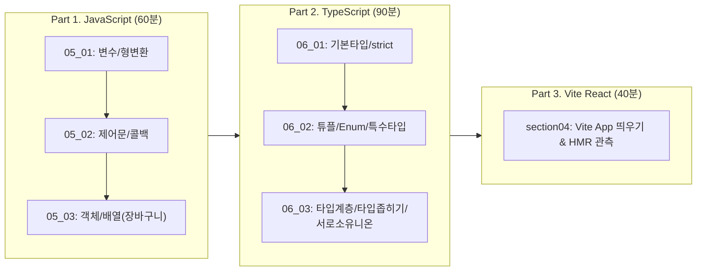

# [실습 & 아키텍처 가이드] 1. JavaScript 핵심 문법, TypeScript 타입 시스템 및 Vite 기초 실습 가이드

이 문서는 **`C:\Users\user\Downloads\practice\daily\07_01`의 1일차 6대 실습 미션(자바스크립트 복습 05_01~03, 타입스크립트 기초/심화 06_01~03, Vite 첫걸음 section04)**을 완벽히 마스터할 수 있도록, 단순한 힌트 수준을 넘어 **모든 실습 파일의 100% 완성 코드, 실행 명령어, 콘솔 출력 결과, Java와의 1:1 비교 해설**을 집대성한 가이드입니다.

---

## 📌 목차

1. [1일차 전체 학습 로드맵 및 Java vs JS/TS 패러다임 비교](#1-1일차-전체-학습-로드맵-및-java-vs-jsts-패러다임-비교)
2. [프로젝트 구조 및 실습 파일 배치도](#2-프로젝트-구조-및-실습-파일-배치도)
3. [사전 준비: 패키지 설치 및 실행 환경](#3-사전-준비-패키지-설치-및-실행-환경)
4. [Part 1: JavaScript 핵심 문법 완성 코드 (05_01 ~ 05_03)](#part-1-javascript-핵심-문법-완성-코드-05_01--05_03)
   - 4-1. [05_01] 변수·상수·자료형·형 변환 (`01_javascript/05_01_basic/basic.js`)
   - 4-2. [05_02] 연산자·조건문·반복문·콜백 함수 (`01_javascript/05_02_control/control.js`)
   - 4-3. [05_03-1] 전역/지역/블록 스코프 (`01_javascript/05_03_object_array/scope.js`)
   - 4-4. [05_03-2] 객체 리터럴 & 메서드 (`01_javascript/05_03_object_array/user.js`)
   - 4-5. [05_03-3] 장바구니 배열+객체 집계 (`01_javascript/05_03_object_array/cart.js`)
5. [Part 2: TypeScript 타입 시스템 완성 코드 (06_01 ~ 06_03)](#part-2-typescript-타입-시스템-완성-코드-06_01--06_03)
   - 5-1. [06_01-1] TS 환경 점검 & 원시 타입 (`02_typescript/src/06_01_basic/index.ts`)
   - 5-2. [06_01-2] 리터럴 타입 & strict 모드 (`02_typescript/src/06_01_basic/types.ts`)
   - 5-3. [06_02-1] 배열 & 튜플 타입 (`02_typescript/src/06_02_types/arrays.ts`)
   - 5-4. [06_02-2] 객체 타입 & 인덱스 시그니처 (`02_typescript/src/06_02_types/objects.ts`)
   - 5-5. [06_02-3] 숫자형/문자열 Enum (`02_typescript/src/06_02_types/enums.ts`)
   - 5-6. [06_02-4] 특수 타입: any, unknown, void, never (`02_typescript/src/06_02_types/special-types.ts`)
   - 5-7. [06_03-1] 타입 호환성(업/다운캐스팅) & 초과 프로퍼티 (`02_typescript/src/06_03_advanced/compatibility.ts`)
   - 5-8. [06_03-2] 타입 추론 & 타입 좁히기 (`02_typescript/src/06_03_advanced/type-narrowing.ts`)
   - 5-9. [06_03-3] 대수 타입 & 서로소 유니온 (`02_typescript/src/06_03_advanced/algebraic-types.ts`)
   - 5-10. [06_03-4] 타입 단언(as, as const, !) (`02_typescript/src/06_03_advanced/type-assertion.ts`)
6. [Part 3: Vite React 첫 화면 실습 (section04)](#part-3-vite-react-첫-화면-실습-section04)
7. [미션별 결과 검증 체크리스트](#7-미션별-결과-검증-체크리스트)
8. [자주 겪는 실수 & 디버깅 가이드 (FAQ)](#8-자주-겪는-실수--디버깅-가이드-faq)

---

## 1. 1일차 전체 학습 로드맵 및 Java vs JS/TS 패러다임 비교



### 💡 Java 개발자를 위한 멘탈 모델 전환표

| 구분 | Java (Spring Boot) | JavaScript / TypeScript |
| :--- | :--- | :--- |
| **타입 결정 시점** | 컴파일 타임에 정적 바인딩 (엄격함) | JS는 런타임 동적 타입 / TS는 컴파일 시점 검사 후 **런타임에는 타입이 증발(Erasure)** |
| **타입 비교 방식** | **명목적 타이핑 (Nominal Typing)**<br>클래스 이름이 같거나 상속 관계여야 호환됨 | **구조적 타이핑 (Structural Typing / 덕 타이핑)**<br>이름이 달라도 가진 프로퍼티(속성) 형태가 같으면 호환됨 |
| **형 변환 / 캐스팅** | `(Integer) obj` (실패 시 `ClassCastException`) | TS의 `as`는 컴파일러에게 "내가 맞으니 참견 마라"는 **타입 단언(Assertion)**일 뿐 런타임 변환 X |
| **타입 가드** | `if (obj instanceof Member) { ... }` | `typeof`, `instanceof`, `in`, 또는 태그 프로퍼티를 이용한 **서로소 유니온(Disjoint Union)** |
| **함수** | 클래스 안의 메서드로만 존재 | 일급 객체(First-class Citizen) ➜ 변수에 대입, 인자로 전달(콜백), 반환 가능 |

---

## 2. 프로젝트 구조 및 실습 파일 배치도

```text
practice_JavaScript/
 ├── .gitignore
 ├── package.json
 ├── tsconfig.json
 ├── docs/guide/1.JS_TS_DAILY01_PRACTICE_GUIDE.md
 │
 ├── 01_javascript/
 │    ├── 05_01_basic/ (index.html, basic.js)
 │    ├── 05_02_control/ (control.js)
 │    └── 05_03_object_array/ (scope.js, user.js, cart.js)
 │
 ├── 02_typescript/src/
 │    ├── 06_01_basic/ (index.ts, types.ts)
 │    ├── 06_02_types/ (arrays.ts, objects.ts, enums.ts, special-types.ts)
 │    └── 06_03_advanced/ (compatibility.ts, type-narrowing.ts, algebraic-types.ts, type-assertion.ts)
 │
 └── 03_vite_react/
      └── README.md
```

---

## 3. 사전 준비: 패키지 설치 및 실행 환경

프로젝트 루트(`practice_JavaScript`)에서 아래 명령으로 의존성을 확인합니다:

```powershell
npm install
```

- **JavaScript 실행**: `node 01_javascript/.../파일명.js`
- **TypeScript 실행**: `npx tsx 02_typescript/src/.../파일명.ts` (`tsx`를 통해 컴파일 없이 즉시 실행)

---

## Part 1: JavaScript 핵심 문법 완성 코드 (05_01 ~ 05_03)

### 4-1. [05_01] 변수·상수·자료형·형 변환 (`01_javascript/05_01_basic/basic.js`)
- **실행**: `node 01_javascript/05_01_basic/basic.js`

```javascript
/**
 * [05_01_js_basic] 자바스크립트 변수·상수·자료형·형 변환 실습
 */

// ==========================================
// 1단계: 변수를 이용한 간단한 정보 출력
// ==========================================
console.log('=== 1단계: 변수/상수 선언 및 출력 ===');

let userName = '홍길동'; // 변수 (재할당 가능)
let userAge = 30;
const userJob = '개발자'; // 상수 (재할당 불가)

console.log('이름:', userName);
console.log('나이:', userAge);
console.log('직업:', userJob);

// 상수 재할당 시도 에러 관측
try {
  // @ts-ignore
  userJob = '디자이너'; // ❌ TypeError 발생
} catch (error) {
  console.log('상수 재할당 시도 결과 에러:', error.message);
}

// ==========================================
// 2단계: 다양한 자료형과 템플릿 리터럴 사용
// ==========================================
console.log('\n=== 2단계: 자료형 & 템플릿 리터럴 ===');

const count = 10;                     // Number
const greeting = '안녕하세요';          // String
const isDeveloper = true;             // Boolean
const emptyValue = null;              // Null (명시적 빈 값)
let notAssigned;                      // Undefined (초기화되지 않음)

// 백틱(``)을 이용한 템플릿 리터럴
const message = `${userName}(${userAge}세)은 ${userJob}입니다: ${isDeveloper}`;
console.log('템플릿 리터럴 메시지:', message);

// typeof 연산자로 자료형 확인
console.log('typeof count:', typeof count);             // number
console.log('typeof greeting:', typeof greeting);       // string
console.log('typeof isDeveloper:', typeof isDeveloper); // boolean
console.log('typeof emptyValue:', typeof emptyValue);   // object (JS 초기 버그!)
console.log('typeof notAssigned:', typeof notAssigned); // undefined

// ==========================================
// 3단계: 형 변환 실수 찾기 & 고치기
// ==========================================
console.log('\n=== 3단계: 형 변환 비교 & NaN 테스트 ===');

const strNum1 = '10';
const strNum2 = '5';

// 묵시적 형 변환 (문자열 결합)
console.log('"10" + "5" =', strNum1 + strNum2); // "105"

// 명시적 형 변환 (숫자 덧셈)
console.log('Number("10") + Number("5") =', Number(strNum1) + Number(strNum2)); // 15
console.log('parseInt("10.7") =', parseInt('10.7'));                             // 10
console.log('parseFloat("10.7") =', parseFloat('10.7'));                         // 10.7

// 불리언 형 변환 (Truthy vs Falsy)
console.log('Boolean("") =', Boolean(''));       // false (빈 문자열)
console.log('Boolean(0) =', Boolean(0));         // false
console.log('Boolean("hello") =', Boolean('hello')); // true

// NaN(Not a Number) 함수 비교
const invalidNumber = Number('hello');
console.log('Number("hello") =', invalidNumber); // NaN
console.log('isNaN("hello") =', isNaN('hello'));               // true (전역 isNaN은 먼저 숫자로 변환 후 검사)
console.log('Number.isNaN("hello") =', Number.isNaN('hello')); // false (오직 값 자체가 NaN일 때만 true, 엄격)
console.log('Number.isNaN(invalidNumber) =', Number.isNaN(invalidNumber)); // true
```

---

### 4-2. [05_02] 연산자·조건문·반복문·콜백 함수 (`01_javascript/05_02_control/control.js`)
- **실행**: `node 01_javascript/05_02_control/control.js`

```javascript
/**
 * [05_02_js_control] 연산자·조건문·반복문·함수로 로직 만들기 실습
 */

// ==========================================
// 1단계: 점수에 따른 학점 계산기 만들기 (if-else & switch)
// ==========================================
console.log('=== 1단계: 학점 계산기 ===');

function getGradeIf(score) {
  if (score >= 90) return 'A';
  if (score >= 80) return 'B';
  if (score >= 70) return 'C';
  if (score >= 60) return 'D';
  return 'F';
}

function getGradeSwitch(score) {
  // 10으로 나눈 몫으로 그룹화
  const quotient = Math.floor(score / 10);
  switch (quotient) {
    case 10:
    case 9:
      return 'A';
    case 8:
      return 'B';
    case 7:
      return 'C';
    case 6:
      return 'D';
    default:
      return 'F';
  }
}

const testScores = [95, 82, 67, 40];
testScores.forEach(s => {
  console.log(`[if문] 점수: ${s}, 학점: ${getGradeIf(s)} | [switch문] 학점: ${getGradeSwitch(s)}`);
});

// ==========================================
// 2단계: 반복문으로 누적 합과 짝수만 더하기
// ==========================================
console.log('\n=== 2단계: for 문과 continue/break ===');

// 1. 1부터 100까지의 합 (기대값: 5050)
let sumAll = 0;
for (let i = 1; i <= 100; i++) {
  sumAll += i;
}
console.log('1부터 100까지 전체 합:', sumAll); // 5050

// 2. 1부터 100까지 짝수만 더하기 (continue 활용, 기대값: 2550)
let sumEven = 0;
for (let i = 1; i <= 100; i++) {
  if (i % 2 !== 0) continue; // 홀수면 건너뛰기
  sumEven += i;
}
console.log('1부터 100까지 짝수 합:', sumEven); // 2550

// 3. 누적 합이 200을 넘으면 중단 (break 활용)
let sumBreak = 0;
let stopNumber = 0;
for (let i = 1; i <= 100; i++) {
  sumBreak += i;
  if (sumBreak > 200) {
    stopNumber = i;
    break;
  }
}
console.log(`누적 합이 200을 넘는 시점: 1부터 ${stopNumber}까지 합 = ${sumBreak}`); // 20까지 더하면 210

// ==========================================
// 3단계: 함수로 로직 분리 + 콜백 연습
// ==========================================
console.log('\n=== 3단계: 함수 분리, 콜백, 삼항/null병합 연산자 ===');

// 콜백 함수를 매개변수로 받는 고차 함수
function printGrade(name, score, callback) {
  const grade = getGradeIf(score);
  // 전달받은 콜백 함수 실행
  callback(name, score, grade);
}

// 콜백 형태 1: 기본 출력
printGrade('철수', 85, (name, score, grade) => {
  console.log(`[표준] ${name} 학생은 ${score}점으로 ${grade}학점입니다.`);
});

// 콜백 형태 2: 커스텀 포맷팅
printGrade('영희', 95, (name, score, grade) => {
  console.log(`🎉 [우수생 알림] ${name} 학생 ${grade}학점 달성! (점수: ${score})`);
});

// 삼항 연산자
const score = 75;
const passStatus = score >= 60 ? '합격' : '불합격';
console.log(`점수 ${score}점 판정: ${passStatus}`);

// null 병합 연산자 (??)
const inputName = null;
const finalName = inputName ?? '익명 사용자';
console.log('null 병합 결과:', finalName); // 익명 사용자
```

---

### 4-3. [05_03-1] 전역/지역/블록 스코프 (`01_javascript/05_03_object_array/scope.js`)
- **실행**: `node 01_javascript/05_03_object_array/scope.js`

```javascript
/**
 * [05_03_js_object_array - 1단계] 전역/지역 스코프 체험하기
 */

console.log('=== 1단계: 전역 스코프 vs 지역 스코프 ===');

const globalVar = '나는 전역 변수입니다.';

function testScope() {
  const localVar = '나는 함수 내부의 지역 변수입니다.';
  const shadowVar = '지역에서 가려진 변수';

  console.log('[함수 내부] globalVar 접근:', globalVar);
  console.log('[함수 내부] localVar 접근:', localVar);
}

testScope();

// 블록 스코프 테스트 (let, const)
if (true) {
  const blockConst = '블록 안의 상수';
  var blockVar = 'var로 선언한 변수 (함수 스코프)';
}

console.log('[블록 외부] var 접근 가능 여부:', blockVar); // 접근 가능

try {
  // @ts-ignore
  console.log(blockConst); // ❌ ReferenceError
} catch (error) {
  console.log('[블록 외부] let/const 블록 바깥 접근 불가 에러:', error.message);
}
```

---

### 4-4. [05_03-2] 객체 리터럴 & 메서드 (`01_javascript/05_03_object_array/user.js`)
- **실행**: `node 01_javascript/05_03_object_array/user.js`

```javascript
/**
 * [05_03_js_object_array - 2단계] 객체로 사용자 정보 표현하기
 */

console.log('=== 2단계: 객체 다루기 & 메서드 ===');

// 객체 리터럴 생성
const user = {
  name: '홍길동',
  age: 28,
  email: 'hong@example.com',
  address: '서울특별시 강남구',
  // 메서드 정의
  printInfo() {
    console.log(`[회원정보] ${this.name} (${this.age}세) / 이메일: ${this.email}`);
  },
};

// 1. 프로퍼티 접근 (점 표기법 vs 대괄호 표기법)
console.log('점 표기법 (user.name):', user.name);
console.log('대괄호 표기법 (user["email"]):', user['email']);

// 2. 프로퍼티 추가 및 수정
user.job = '백엔드 개발자'; // 추가
user.age = 29;              // 수정
console.log('수정 후 나이:', user.age);
console.log('추가된 직업:', user.job);

// 3. in 연산자로 프로퍼티 존재 확인
console.log('"email" in user:', 'email' in user);       // true
console.log('"phoneNumber" in user:', 'phoneNumber' in user); // false

// 4. 프로퍼티 삭제
delete user.address;
console.log('address 삭제 후 user:', user);

// 5. 메서드 호출
user.printInfo();
```

---

### 4-5. [05_03-3] 장바구니 배열+객체 집계 (`01_javascript/05_03_object_array/cart.js`)
- **실행**: `node 01_javascript/05_03_object_array/cart.js`

```javascript
/**
 * [05_03_js_object_array - 3단계] 배열 + 객체로 장바구니 구조 만들기
 */

console.log('=== 3단계: 장바구니 배열 & 객체 조작 ===');

// 1. 장바구니 배열 선언 (객체 3개)
const cartItems = [
  { name: '기계식 키보드', price: 120000, quantity: 1 },
  { name: '무선 마우스', price: 45000, quantity: 2 },
  { name: '모니터 암', price: 68000, quantity: 1 },
];

console.log('초기 장바구니 아이템 수:', cartItems.length);

// 2. 총 금액 집계 함수 (반복문 & reduce)
function calculateTotal(items) {
  return items.reduce((acc, item) => acc + item.price * item.quantity, 0);
}

console.log(`현재 총 결제 금액: ${calculateTotal(cartItems).toLocaleString()}원`);

// 3. 아이템 추가 (push)
cartItems.push({ name: '장패드', price: 15000, quantity: 2 });
console.log('아이템 추가 후 총액:', `${calculateTotal(cartItems).toLocaleString()}원`);

// 4. 특정 아이템 수량 수정 (find)
const mouseItem = cartItems.find(item => item.name === '무선 마우스');
if (mouseItem) {
  mouseItem.quantity = 3; // 수량 변경
  console.log('무선 마우스 수량 3개로 변경 완료');
}

// 5. 특정 아이템 삭제 (splice or filter)
const targetIndex = cartItems.findIndex(item => item.name === '모니터 암');
if (targetIndex !== -1) {
  cartItems.splice(targetIndex, 1); // 1개 삭제
  console.log('모니터 암 삭제 완료');
}

console.log('\n--- 최종 장바구니 내역 ---');
cartItems.forEach((item, idx) => {
  console.log(`${idx + 1}. ${item.name} | 단가: ${item.price.toLocaleString()}원 | 수량: ${item.quantity}개`);
});
console.log(`최종 결제 금액: ${calculateTotal(cartItems).toLocaleString()}원`);
```

---

## Part 2: TypeScript 타입 시스템 완성 코드 (06_01 ~ 06_03)

### 5-1. [06_01-1] TS 환경 점검 & 원시 타입 (`02_typescript/src/06_01_basic/index.ts`)
- **실행**: `npx tsx 02_typescript/src/06_01_basic/index.ts`

```typescript
/**
 * [06_01_ts_basic - 1~2단계] TypeScript 환경 구축 및 첫 실행
 */

console.log('=== 06_01: 첫 번째 TypeScript 코드 ===');

console.log('Hello TypeScript');

// 원시 타입(Primitive Types)과 명시적 타입 주석(Type Annotation)
let age: number = 25;
let username: string = '이순신';
let isStudent: boolean = false;

console.log(`이름: ${username}, 나이: ${age}, 학생 여부: ${isStudent}`);

// 타입 안전성: 다른 자료형 할당 시 컴파일 에러 발생
// age = "스물다섯"; // ❌ Type 'string' is not assignable to type 'number'.
```

---

### 5-2. [06_01-2] 리터럴 타입 & strict 모드 (`02_typescript/src/06_01_basic/types.ts`)
- **실행**: `npx tsx 02_typescript/src/06_01_basic/types.ts`

```typescript
/**
 * [06_01_ts_basic - 3~4단계] 기본 타입과 리터럴 타입 & strict 모드
 */

console.log('=== 06_01: 기본 타입 & 리터럴 타입 & 타입 추론 ===');

// 1. 원시 타입 변수
let num: number = 100;
let str: string = 'TypeScript';
let bool: boolean = true;
let nullVal: null = null;
let undefinedVal: undefined = undefined;

// 2. 리터럴 타입 (특정 값 자체를 타입으로 지정)
let exactTen: 10 = 10;
let greetingLiteral: 'hello' = 'hello';
// exactTen = 11; // ❌ Type '11' is not assignable to type '10'.

// 3. 리터럴 유니온 (API 응답 상태에 자주 활용)
type ApiStatus = 'success' | 'error' | 'loading';

let currentStatus: ApiStatus = 'loading';
currentStatus = 'success'; // OK
// currentStatus = "failed"; // ❌ 오타 방지! Type '"failed"' is not assignable to type 'ApiStatus'.
console.log('현재 API 상태:', currentStatus);

// 4. 타입 추론(Type Inference)
let inferredNum = 50; // number로 자동 추론됨
// inferredNum = "fifty"; // ❌ 컴파일러가 number로 추론했으므로 에러

// 5. null 안전성 (strictNullChecks)
// string | null 유니온으로 명시해야만 null을 안전하게 수용 가능
let nullableString: string | null = null;
nullableString = '안전한 문자열';
console.log('nullableString:', nullableString);
```

---

### 5-3. [06_02-1] 배열 & 튜플 타입 (`02_typescript/src/06_02_types/arrays.ts`)
- **실행**: `npx tsx 02_typescript/src/06_02_types/arrays.ts`

```typescript
/**
 * [06_02_ts_types - 1단계] 배열과 튜플 타입 실습
 */

console.log('=== 06_02: 배열(Array)과 튜플(Tuple) 타입 ===');

// 1. 단일 타입 배열
const numbers: number[] = [1, 2, 3, 4, 5];
const words: Array<string> = ['Java', 'Spring', 'TypeScript'];

// 2. 유니온 타입 배열 (숫자와 문자열 혼합)
const mixed: (number | string)[] = [1, 'two', 3, 'four'];

// 3. 2차원 배열 (행렬)
const matrix: number[][] = [
  [1, 2, 3],
  [4, 5, 6],
];
console.log('2차원 배열 [1][2]:', matrix[1][2]); // 6

// 4. 튜플(Tuple): 길이와 각 인덱스의 타입 순서가 고정된 배열
let userTuple: [number, string, boolean];
userTuple = [1, '홍길동', true]; // 정확한 순서
// userTuple = ["홍길동", 1, true]; // ❌ 순서 불일치 에러!

console.log(`튜플 데이터 - ID: ${userTuple[0]}, 이름: ${userTuple[1]}`);

// 튜플 배열
const members: [number, string][] = [
  [1, '김철수'],
  [2, '이영희'],
];
console.log('회원 튜플 목록:', members);
```

---

### 5-4. [06_02-2] 객체 타입 & 인덱스 시그니처 (`02_typescript/src/06_02_types/objects.ts`)
- **실행**: `npx tsx 02_typescript/src/06_02_types/objects.ts`

```typescript
/**
 * [06_02_ts_types - 2단계] 객체 타입과 타입 별칭(Type Alias) 실습
 */

console.log('=== 06_02: 객체 리터럴, 선택적/readonly 프로퍼티, 인덱스 시그니처 ===');

// 1. 타입 별칭(Type Alias) 정의
type UserProfile = {
  readonly id: number;      // 수정 불가 읽기 전용 (Java의 final 필드)
  name: string;
  email: string;
  nickname?: string;        // 선택적 프로퍼티 (Optional, 있어도 되고 없어도 됨)
};

const user1: UserProfile = {
  id: 101,
  name: '홍길동',
  email: 'hong@test.com',
};

// user1.id = 102; // ❌ Cannot assign to 'id' because it is a read-only property.
user1.name = '홍길동(수정)'; // OK
console.log('User1 프로퍼티:', user1);

// 2. 인덱스 시그니처 (동적으로 키와 값이 추가되는 사전형 객체)
type CountryCodeMap = {
  [countryCode: string]: string; // 키도 string, 값도 string
};

const countryCodes: CountryCodeMap = {
  kr: '대한민국',
  us: '미국',
  jp: '일본',
  uk: '영국',
};

console.log('국가 코드 kr:', countryCodes.kr);
```

---

### 5-5. [06_02-3] 숫자형/문자열 Enum (`02_typescript/src/06_02_types/enums.ts`)
- **실행**: `npx tsx 02_typescript/src/06_02_types/enums.ts`

```typescript
/**
 * [06_02_ts_types - 3단계] Enum 타입 실습
 */

console.log('=== 06_02: 숫자형 & 문자열 열거형(Enum) ===');

// 1. 숫자형 Enum (자동으로 0부터 순차 증가)
enum Role {
  ADMIN, // 0
  USER,  // 1
  GUEST, // 2
}

console.log('Role.ADMIN 값:', Role.ADMIN); // 0
console.log('Role.USER 값:', Role.USER);   // 1
console.log('Role 역방향 매핑 (Role[0]):', Role[0]); // "ADMIN"

// 2. 문자열 Enum (명시적 값 지정)
enum Language {
  KOREAN = 'ko',
  ENGLISH = 'en',
  JAPANESE = 'ja',
}

console.log('Language.KOREAN 값:', Language.KOREAN); // "ko"

// 3. Enum을 활용한 데이터 모델링
type Account = {
  username: string;
  role: Role;
  lang: Language;
};

const adminAccount: Account = {
  username: 'superAdmin',
  role: Role.ADMIN,
  lang: Language.KOREAN,
};

console.log('관리자 계정 정보:', adminAccount);
```

---

### 5-6. [06_02-4] 특수 타입: any, unknown, void, never (`02_typescript/src/06_02_types/special-types.ts`)
- **실행**: `npx tsx 02_typescript/src/06_02_types/special-types.ts`

```typescript
/**
 * [06_02_ts_types - 4단계] any, unknown, void, never 특수 타입 실습
 */

console.log('=== 06_02: 특수 타입 (any, unknown, void, never) ===');

// 1. any: 타입 검사를 완전히 포기 (지양해야 함)
let anyVal: any = 10;
anyVal = '문자열';
anyVal = () => console.log('함수'); // 에러 없음 (하지만 런타임 버그의 주범)

// 2. unknown: 모든 값을 허용하지만, 타입 검사(타입 좁히기) 전에는 사용 불가 (안전함!)
let unknownVal: unknown = 'Hello Unknown';
// unknownVal.toUpperCase(); // ❌ Object is of type 'unknown'.

// 타입 좁히기(typeof)를 거치면 안전하게 사용 가능
if (typeof unknownVal === 'string') {
  console.log('unknown 값 안전 호출:', unknownVal.toUpperCase());
}

// 3. void: 반환값이 없는 함수
function logMessage(msg: string): void {
  console.log(`[로그 출력]: ${msg}`);
  return;
}
logMessage('void 테스트');

// 4. never: 절대 정상적으로 값을 반환하지 않는 함수 (무한 루프 또는 예외 발생)
function throwFatalError(message: string): never {
  throw new Error(`[치명적 오류]: ${message}`);
}

try {
  throwFatalError('시스템 중단');
} catch (e: any) {
  console.log('never 함수 예외 포착:', e.message);
}
```

---

### 5-7. [06_03-1] 타입 호환성(업/다운캐스팅) & 초과 프로퍼티 (`02_typescript/src/06_03_advanced/compatibility.ts`)
- **실행**: `npx tsx 02_typescript/src/06_03_advanced/compatibility.ts`

```typescript
/**
 * [06_03_ts_advanced - 1단계] 타입 호환성(Type Compatibility) 실습
 */

console.log('=== 06_03: 타입 계층, 업캐스팅 & 다운캐스팅, 초과 프로퍼티 검사 ===');

// 1. 리터럴 타입과 기본 타입 호환성
let numLiteral: 10 = 10;
let normalNum: number = 20;

normalNum = numLiteral; // 🟢 업캐스팅 (Sub ➜ Super): 허용!
// numLiteral = normalNum; // ❌ 다운캐스팅 (Super ➜ Sub): 컴파일 에러!

// 2. 객체 타입의 구조적 호환성 (프로퍼티가 적은 쪽이 슈퍼타입!)
type Animal = {
  name: string;
};

type Dog = {
  name: string;
  breed: string; // 추가 프로퍼티
};

let animal: Animal = { name: '동물' };
let dog: Dog = { name: '백구', breed: '진돗개' };

animal = dog; // 🟢 업캐스팅: Dog는 Animal의 조건을 모두 만족하므로 허용!
console.log('업캐스팅된 동물 이름:', animal.name);
// dog = animal; // ❌ 다운캐스팅: breed 프로퍼티가 없으므로 거부!

// 3. 초과 프로퍼티 검사 (Excess Property Checks)
// 객체 리터럴을 '직접' 할당할 때는 정의되지 않은 여분 프로퍼티를 엄격히 차단
/*
let pet: Animal = {
  name: "나비",
  breed: "코숏" // ❌ 에러! 객체 리터럴 직접 할당 시에는 초과 프로퍼티 차단
};
*/
// 하지만 변수에 먼저 담아 전달하면 통과됨
const tempCat = { name: '나비', breed: '코숏' };
let pet: Animal = tempCat; // 🟢 통과
console.log('초과 프로퍼티 검사 우회:', pet);
```

---

### 5-8. [06_03-2] 타입 추론 & 타입 좁히기 (`02_typescript/src/06_03_advanced/type-narrowing.ts`)
- **실행**: `npx tsx 02_typescript/src/06_03_advanced/type-narrowing.ts`

```typescript
/**
 * [06_03_ts_advanced - 2단계] 타입 추론과 타입 좁히기(Type Narrowing)
 */

console.log('=== 06_03: 타입 좁히기 (typeof, instanceof, in 타입 가드) ===');

// 1. typeof 타입 가드
function formatInput(val: number | string) {
  if (typeof val === 'number') {
    // 이 블록 안에서는 val이 number로 100% 좁혀짐
    return val.toFixed(2);
  } else {
    // 이 블록 안에서는 val이 string으로 100% 좁혀짐
    return val.trim().toUpperCase();
  }
}

console.log('typeof 좁히기 (숫자):', formatInput(3.141592)); // "3.14"
console.log('typeof 좁히기 (문자):', formatInput('   hello react   ')); // "HELLO REACT"

// 2. instanceof 타입 가드 (객체 인스턴스 검사)
function printDateOrString(input: Date | string) {
  if (input instanceof Date) {
    console.log('Date 객체 밀리초:', input.getTime());
  } else {
    console.log('문자열 길이:', input.length);
  }
}

printDateOrString(new Date());
printDateOrString('2026-10-15');

// 3. in 연산자 타입 가드 (특정 프로퍼티 소유 여부 검사)
type Person = { name: string; age: number };
type Car = { name: string; maxSpeed: number };

function describeEntity(entity: Person | Car) {
  if ('age' in entity) {
    console.log(`사람: ${entity.name}, 나이: ${entity.age}세`);
  } else {
    console.log(`자동차: ${entity.name}, 최고속도: ${entity.maxSpeed}km/h`);
  }
}

describeEntity({ name: '홍길동', age: 30 });
describeEntity({ name: '스포츠카', maxSpeed: 280 });
```

---

### 5-9. [06_03-3] 대수 타입 & 서로소 유니온 (`02_typescript/src/06_03_advanced/algebraic-types.ts`)
- **실행**: `npx tsx 02_typescript/src/06_03_advanced/algebraic-types.ts`

```typescript
/**
 * [06_03_ts_advanced - 3단계] 대수 타입 (유니온, 인터섹션, 서로소 유니온)
 */

console.log('=== 06_03: 유니온, 인터섹션, 서로소 유니온(Disjoint Union) ===');

// 1. 유니온 타입 (|): 합집합 (둘 중 하나 이상의 성질)
type StringOrNumber = string | number;
let sampleVal: StringOrNumber = '텍스트';
sampleVal = 100;

// 2. 인터섹션 타입 (&): 교집합 (두 타입의 프로퍼티를 모두 포함)
type Identifiable = { id: string };
type Timestamped = { createdAt: Date };
type UserLog = Identifiable & Timestamped;

const log: UserLog = {
  id: 'log-001',
  createdAt: new Date(),
};
console.log('인터섹션 객체:', log);

// ==========================================
// 3. [핵심] 서로소 유니온 (태그 프로퍼티를 가진 배타적 유니온)
// ==========================================
type AdminUser = {
  tag: 'ADMIN'; // 리터럴 타입의 태그
  name: string;
  kickOut: () => void;
};

type MemberUser = {
  tag: 'MEMBER';
  name: string;
  points: number;
};

type GuestUser = {
  tag: 'GUEST';
  name: string;
};

type AppUser = AdminUser | MemberUser | GuestUser;

function handleLoginUser(user: AppUser) {
  // switch 문에서 user.tag를 비교하는 순간,
  // TypeScript가 각 case 블록마다 해당 유저의 구체적 타입을 완벽하게 좁혀줍니다!
  switch (user.tag) {
    case 'ADMIN':
      console.log(`[관리자] ${user.name} 님이 로그인했습니다.`);
      user.kickOut(); // Admin 고유 메서드 호출 가능!
      break;
    case 'MEMBER':
      console.log(`[회원] ${user.name} 님의 적립 포인트는 ${user.points}P 입니다.`);
      break;
    case 'GUEST':
      console.log(`[게스트] ${user.name} 님 환영합니다. 회원가입을 진행해 주세요.`);
      break;
  }
}

handleLoginUser({ tag: 'ADMIN', name: '슈퍼관리자', kickOut: () => console.log('사용자 강퇴 실행!') });
handleLoginUser({ tag: 'MEMBER', name: '김철수', points: 3500 });
handleLoginUser({ tag: 'GUEST', name: '방문객1' });
```

---

### 5-10. [06_03-4] 타입 단언(as, as const, !) (`02_typescript/src/06_03_advanced/type-assertion.ts`)
- **실행**: `npx tsx 02_typescript/src/06_03_advanced/type-assertion.ts`

```typescript
/**
 * [06_03_ts_advanced - 4단계] 타입 단언(Type Assertion) 실습
 */

console.log('=== 06_03: 타입 단언 (as 키워드, const 단언, Non-null 단언 !) ===');

type Student = {
  name: string;
  grade: number;
};

// 1. as 키워드로 빈 객체 타입 단언 (초기화 시점 편의성)
const emptyStudent = {} as Student;
emptyStudent.name = '홍길동';
emptyStudent.grade = 3;
console.log('단언된 학생 객체:', emptyStudent);

// 2. 다중 단언 (A as unknown as B)
// 서로 연관 없는 타입 간에는 직접 단언 불가 ➜ unknown을 거쳐서 강제 단언
const forcedString = (123 as unknown) as string;
console.log('다중 단언 결과 타입:', typeof forcedString); // number (런타임에는 여전히 숫자!)

// 3. const 단언 (as const)
// 객체나 배열을 깊은 불변(readonly) 및 리터럴 타입으로 고정
const appConfig = {
  serverUrl: 'https://api.myproject.com',
  port: 8080,
  mode: 'production',
} as const;

// appConfig.port = 9090; // ❌ Cannot assign to 'port' because it is a read-only property.
console.log('as const 고정 객체:', appConfig);

// 4. Non-null 단언 연산자 (!)
function getLength(str: string | null | undefined): number {
  // 개발자가 "이 값은 절대 null이나 undefined가 아니다"라고 보증하는 ! 연산자
  return str!.length;
}

console.log('Non-null 단언 결과:', getLength('HelloWorld'));
```

---

## Part 3: Vite React 첫 화면 실습 (section04)

강의 자료 `source_code/onebite-react-v2/section04` 기준의 Vite 첫 화면 띄우기 실습입니다.

```powershell
# 1. 03_vite_react 폴더 이동
cd 03_vite_react

# 2. Vite 기본 React 프로젝트 생성
npm create vite@latest . -- --template react

# 3. 패키지 설치 및 실행
npm install
npm run dev
```

### 📄 `src/App.jsx` 완성 코드

```jsx
import { useState } from 'react';
import './App.css';

function App() {
  const [count, setCount] = useState(0);

  return (
    <div style={{ textAlign: 'center', padding: '50px' }}>
      <h1>⚛️ 안녕 리액트 (Onebite React v2)!</h1>
      <p>Vite를 통해 실시간으로 번들링되어 서빙되는 첫 번째 React 화면입니다.</p>

      <div style={{ marginTop: '20px' }}>
        <button
          onClick={() => setCount(prev => prev + 1)}
          style={{ padding: '10px 20px', fontSize: '16px', cursor: 'pointer' }}
        >
          현재 카운트: {count}
        </button>
      </div>
    </div>
  );
}

export default App;
```

---

## 7. 미션별 결과 검증 체크리스트

모든 파일의 코드를 실행하며 아래 항목들을 확인해 보세요:

- [x] `basic.js`: 상수 재할당 에러(`TypeError`)와 `typeof null`의 `"object"` 출력을 확인했는가?
- [x] `control.js`: `1~100` 합(`5050`)과 짝수 합(`2550`), 200 초과 중단 시점(`210`)이 일치하는가?
- [x] `cart.js`: `reduce` 메서드로 장바구니 4종 상품의 총 결제 금액이 정확히 계산되는가?
- [x] `types.ts`: `ApiStatus` 리터럴 유니온에 정의되지 않은 값을 넣었을 때 TS 컴파일 에러를 관측했는가?
- [x] `arrays.ts`: 튜플 타입 `[number, string]`의 순서가 바뀔 때 에러를 확인했는가?
- [x] `enums.ts`: 숫자형 Enum이 0부터 시작하고 역방향 매핑(`Role[0]`)이 동작하는 것을 확인했는가?
- [x] `special-types.ts`: `unknown` 타입이 `typeof` 검사 없이 메서드를 호출하지 못함을 확인했는가?
- [x] `compatibility.ts`: 프로퍼티가 적은 `Animal`이 슈퍼타입이고 `Dog`가 서브타입임을 확인했는가?
- [x] `algebraic-types.ts`: 서로소 유니온의 `switch(user.tag)` 안에서 각 객체의 고유 프로퍼티가 자동 완성되는가?
- [x] `03_vite_react`: 브라우저(`http://localhost:5173`)에 "안녕 리액트" 화면이 정상 표시되는가?

---

## 8. 자주 겪는 실수 & 디버깅 가이드 (FAQ)

### Q1. `npx tsx` 실행 시 `Cannot find module` 에러가 납니다.
> **해결**: 프로젝트 루트(`practice_JavaScript`)에서 실행해야 합니다. 터미널 경로가 `practice_JavaScript`인지 확인하세요.

### Q2. `as` 타입 단언을 쓰면 런타임 에러가 안 생기나요?
> **주의**: 타입 단언은 **컴파일러의 타입 검사만 우회**하는 것입니다. `(123 as unknown as string).toUpperCase()` 처럼 잘못 단언하면 실제 실행 시 `TypeError: toUpperCase is not a function`이 발생합니다. 항상 `typeof`나 `instanceof` 같은 **타입 가드**를 우선 사용하세요.

### Q3. 서로소 유니온에서 태그 이름은 아무렇게나 지어도 되나요?
> **답변**: 태그 프로퍼티 이름은 `tag`, `type`, `kind` 등 자유롭게 지을 수 있지만, 반드시 **각 타입별로 겹치지 않는 문자열 리터럴 타입(예: `"ADMIN"`, `"MEMBER"`)**이어야 `switch`문에서 정확하게 타입을 좁힐 수 있습니다.
